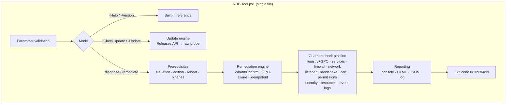

<!-- Last Updated: 2026-10-09 | Version: 5.0.0 -->
<!-- Schema.org: SoftwareApplication, TechArticle -->

# RDP Diagnostic Tool


> **Enterprise-grade PowerShell toolkit for diagnosing, repairing, and monitoring Remote Desktop Protocol (RDP) readiness - a single script, zero dependencies.**

The **RDP Diagnostic & Remediation Tool** gives administrators a systematic, multi-layered RDP health check: OS edition/SKU support, registry and Group Policy overlay, service stack, firewall rules, network profiles, listener state, a **real X.224/RDP protocol handshake probe**, TLS certificate health, permissions, security posture, session lifecycle events and brute-force forensics - with one-switch auto-remediation, HTML/JSON reporting and a built-in self-updater.

---

## 🚀 Quick Start

```powershell
# Full read-only audit of THIS machine (works unelevated, changes nothing)
pwsh -NoProfile -File .\RDP-Tool.ps1

# Enable + repair RDP end-to-end, unattended
pwsh -NoProfile -File .\RDP-Tool.ps1 -EnableRDP -Force

# Probe a REMOTE host: does the RDP stack really answer? Is NLA enforced?
pwsh -NoProfile -File .\RDP-Tool.ps1 -TestRdpTarget "server01.corp.local:3390"

# Who is connected right now?
pwsh -NoProfile -File .\RDP-Tool.ps1 -ShowSessions

# Reports for a ticket / SIEM
pwsh -NoProfile -File .\RDP-Tool.ps1 -ExportReport .\rdp.html -ExportJson .\rdp.json -LogPath .\rdp.log

# Comprehensive built-in help
pwsh -NoProfile -File .\RDP-Tool.ps1 -Help
```

> [!NOTE]
> Requires PowerShell 7+ on Windows 10/11 or Windows Server 2016+. Diagnostics run
> unelevated (reduced coverage); **any change requires Administrator** - add `-Elevate`
> to auto-relaunch through UAC. See [[Installation]].

---

## 🧭 What's New in v5.0.0

- **Comprehensive help** via `-Help` (plus full `Get-Help` integration)
- **Self-update**: `-CheckUpdate` / `-Update` / `-UpdateSource` (GitHub Releases API with validated, backed-up, atomic replacement)
- **Protocol-level probe**: unauthenticated X.224/RDP negotiation handshake against local or remote endpoints (`-TestRdpTarget`)
- **Session view**: `-ShowSessions` (WTS API + qwinsta fallback)
- **New actions**: `-DisableRDP`, `-AddUser`, `-RestartServices`, `-Elevate`, standalone `-SetPort`
- **Automation-ready**: `-ExportJson`, `-LogPath`, `-Quiet`, `-WhatIf`/`-Confirm`, refined exit codes (incl. `5` = update available)
- **~20 correctness fixes** over v4 (Home N detection, PS7-dead `Get-WmiObject`, `Invoke-Expression` remediations, firewall matching on localized systems, TermService trigger-start false positive, ...)

Full details: [[Changelog]].

---

## 📐 Architecture Overview



See [[Architecture]] for design rules and [[Advanced-Diagnostics]] for deep dives.

---

## 📚 Documentation Map

| Page | Contents |
|---|---|
| [[Installation]] | Download, execution policy, elevation, updating |
| [[Usage]] | Full CLI reference, modes, examples, exit codes |
| [[Configuration]] | Every switch in depth, automation recipes, JSON schema |
| [[Troubleshooting]] | Symptom → fix matrix, common RDP failures |
| [[Security]] | Safety model, NLA, firewall hardening notes |
| [[Performance]] | Runtime costs, `-SkipSlowChecks`, fleet execution tips |
| [[Contributing]] | Dev setup, tests, analyzer, release checklist |
| [[Changelog]] | Version history |

---

*[deynekin.com](https://deynekin.com)*
